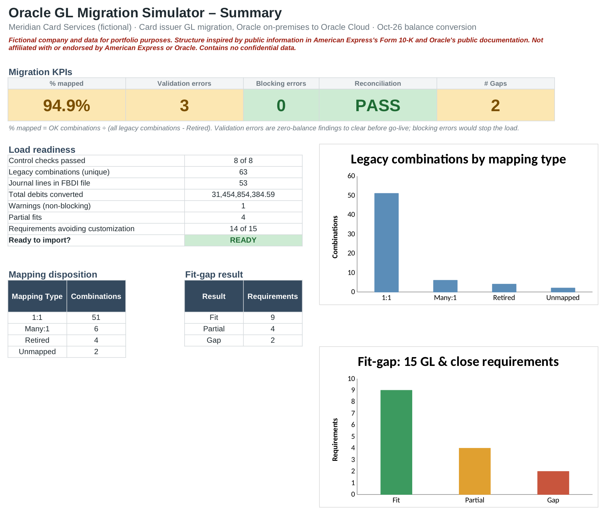
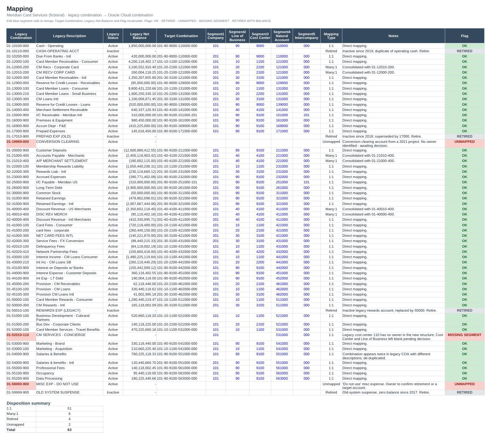
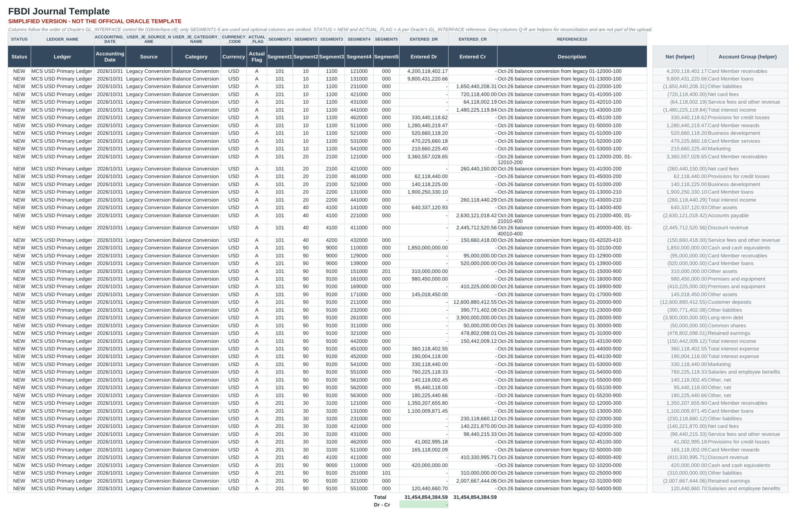
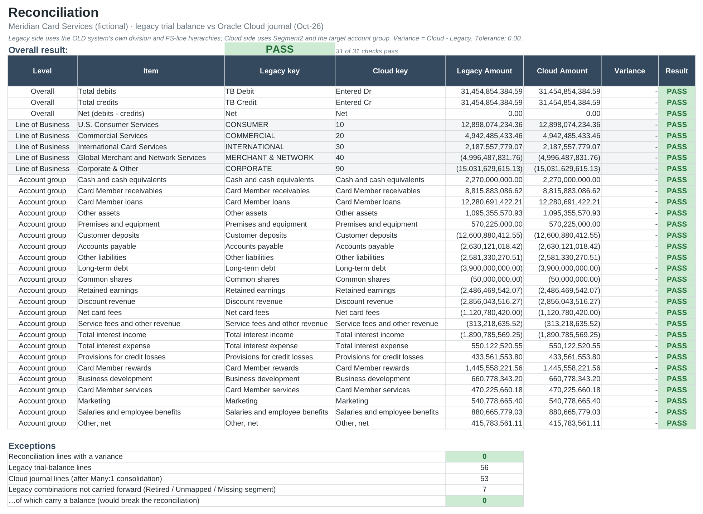
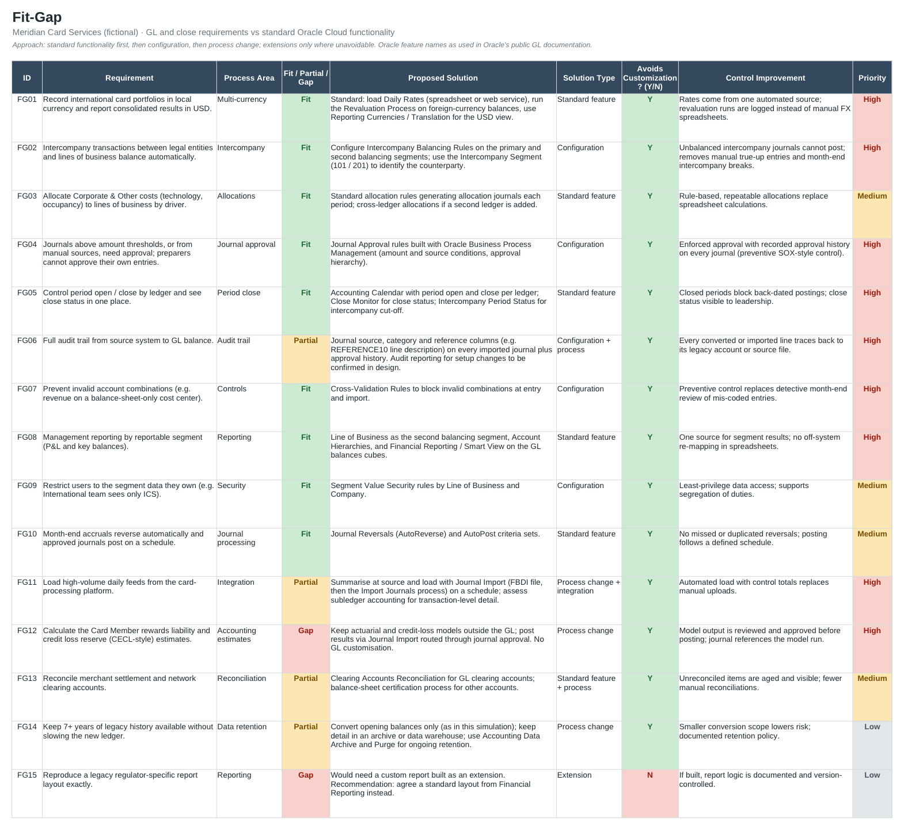

# Oracle GL Migration Simulator – Card Issuer, On-Prem to Cloud

This simulates moving a card issuer's general ledger from **Oracle on-premises to Oracle Cloud**. The Python pipeline takes a messy legacy chart of accounts and trial balance, maps them to a 5-segment Oracle Cloud chart of accounts, and converts the balances into a simplified FBDI-style journal. It then validates the load, reconciles legacy to Cloud, and assesses 15 GL and close requirements against standard Oracle Cloud functionality. Everything lands in one Excel workbook with live formulas and RAG formatting.



> **Disclaimer:** Fictional company and data for portfolio purposes. Structure inspired by public information in American Express's Form 10-K and Oracle's public documentation. Not affiliated with or endorsed by American Express or Oracle. Contains no confidential data.

---

## Context

*Meridian Card Services (fictional)* issues consumer, commercial and international cards and runs a merchant network. Its GL has lived on an on-premises Oracle ledger for 15 years. The chart of accounts uses a 3-part key (Company-Account-CostCenter) and has built up duplicates, dead accounts and inconsistent naming. It has no segment for line of business, so segment reporting is rebuilt in spreadsheets every month.

The move to Oracle Cloud is the chance to fix that. The new chart of accounts has 5 segments, with line of business as a balancing segment. The conversion must be proven complete and accurate before go-live, and the design should use standard Cloud functionality rather than carry over legacy customizations.

## Results (Oct-26 balance conversion)

| | |
|---|---|
| Legacy combinations | 63 unique (64 rows incl. a duplicate), 56 trial-balance lines |
| Mapping | 51 one-to-one · 6 many-to-one · 4 retired · 2 unmapped · **94.9% mapped** |
| FBDI journal | 53 lines, debits = credits = 31,454,854,384.59 (fictional USD) |
| Validation | 8 of 8 control checks PASS · 3 errors + 1 warning, **0 blocking** (all on zero-balance accounts) |
| Reconciliation | **PASS**: 31 of 31 checks (overall, 5 lines of business, 23 account groups), zero variance |
| Fit-gap | 15 requirements: 9 Fit · 4 Partial · 2 Gap · 14 of 15 avoid customization |
| Workbook | 9 sheets, 538 formulas, 0 formula errors after a full recalculation |

<details>
<summary>More screenshots: Mapping, FBDI journal, Reconciliation, Fit-Gap</summary>









</details>

---

## The pipeline, step by step

| Step | Script | What it does |
|---|---|---|
| 1. Legacy data | `src/generate_legacy_data.py` | Builds ~60 legacy accounts in a 3-part format with deliberate mess: a duplicated combination, near-duplicate accounts, inactive/obsolete accounts, inconsistent descriptions (CAPS, abbreviations, trailing spaces), an orphaned cost center and junk accounts. Creates a trial balance that balances overall and per company, with matching intercompany balances. |
| 2. Target COA | `src/mapping.py` | Defines the Oracle Cloud chart of accounts. **Company** (Primary Balancing Segment) · **Line of Business** (Second Balancing Segment) uses the four reportable segment names plus Corporate & Other · **Cost Center** · **Natural Account** (Natural Account Segment), grouped by 10-K statement captions · **Intercompany** (Intercompany Segment). |
| 3. Mapping | `src/mapping.py` | Maps each legacy combination to a target combination. Types are 1:1, Many:1 or Retired, with Unmapped where no decision exists yet. Flags unmapped, retired and missing-segment rows. |
| 4. Transform | `src/transform.py` | Converts the trial balance into a simplified FBDI-style journal (STATUS `NEW`, ACTUAL_FLAG `A`, Segment1–5, Entered Dr/Cr, line description) and consolidates Many:1 mappings. Collects validation errors: unmapped, retired with a balance, missing segment, duplicate, and unbalanced (overall and per company). Errors are **blocking** only when the account carries a balance. A built-in **negative test** feeds in bad data to prove each check fires. |
| 5. Reconcile | `src/reconcile.py` | Compares legacy and Cloud totals overall, by line of business and by account group. The legacy side uses the *old system's own* division and FS-line hierarchies, so the check is independent of the mapping. Exits with an error on any FAIL. |
| 6. Workbook | `src/build_workbook.py` | Adds the fit-gap analysis and writes the workbook. KPIs, flags, control checks and reconciliation lines are live Excel formulas. |

## How to run

Requires Python 3.11+.

```bash
python -m venv .venv
source .venv/bin/activate
pip install -r requirements.txt
```

```bash
python src/generate_legacy_data.py
python src/mapping.py
python src/transform.py
python src/reconcile.py
python src/build_workbook.py
```

Output: `output/Oracle_GL_Migration_Simulator.xlsx`. Intermediate files go to `data/legacy/` and `data/cloud/`.

The scripts write formulas without cached values, so the workbook recalculates when you open it in Excel or LibreOffice. To store the values in the file, for previews or Google Sheets, recalculate once in LibreOffice, for example by opening and saving the file.

**Try it:** on the *Mapping* sheet, clear Segment3 for an account with a balance (for example 01-55100-900, Occupancy). The Flag becomes MISSING SEGMENT, % mapped drops from 94.9% to 93.2%, control check 7 fails, and the Summary's load readiness flips from READY to NOT READY.

## Sheet guide

| Sheet | Contents |
|---|---|
| **Summary** | KPIs: % mapped, validation errors, blocking errors, reconciliation PASS/FAIL, # gaps. Also a load-readiness panel ending in READY / NOT READY, plus mapping-disposition and fit-gap charts. |
| **Legacy COA** | 64 legacy rows with trial balance, legacy division, FS line, 10-K reporting group and a data-quality flag. Shows a BALANCED / OUT OF BALANCE check. |
| **Target COA** | 5 segments with Oracle column, segment label, value, description, account type and 10-K account group. |
| **Mapping** | Legacy → target combination. Segment cells can be edited; target combination, balance and flag (OK / RETIRED / UNMAPPED / MISSING SEGMENT) recalculate. |
| **Fit-Gap** | 15 requirements with process area, Fit / Partial / Gap, proposed solution, solution type, avoids customization (Y/N), control improvement and priority. |
| **FBDI Journal Template** | Simplified GL_INTERFACE-style journal, *not the official Oracle template*. Oracle column names sit above the friendly headers; a totals row and Dr−Cr check sit below. |
| **Validation Errors** | 8 live control checks and the exception log (severity, blocks load, balance, detail, resolution). |
| **Reconciliation** | Legacy vs Cloud for 31 lines with variance and PASS/FAIL, overall result, and an exceptions summary. |
| **About & Sources** | Disclaimer, citations, and a breakdown of what is real, what is fictional, and what was left out because it could not be verified. |

## Skills demonstrated

- **Requirements gathering:** 15 GL and close requirements for a large card issuer, covering multi-currency, intercompany, allocations, journal approval, period close, audit trail, SOX-style controls and segment reporting.
- **Fit-gap analysis:** a standard-first approach (standard feature → configuration → process change → extension), with every gap judged on whether it avoids customization.
- **Chart-of-accounts design:** a 5-segment Oracle Cloud design with balancing segments, an intercompany segment and 10-K-aligned account groups.
- **Data migration:** legacy cleansing (duplicates, retirements, unmapped accounts), Many:1 consolidation, and transformation into FBDI-style import format.
- **Testing:** pre-load validation, a negative test proving each check fires, and an independent 31-line reconciliation with a PASS/FAIL gate.
- **Controls:** preventive checks (balancing per company, complete segments, valid accounts, no orphaned balances) and control improvements for each requirement.
- **Python and Excel:** pandas pipeline, openpyxl workbook with live COUNTIFS / SUMIFS / INDEX-MATCH / SUMPRODUCT formulas, conditional-formatting RAG, data validation and native charts.

## Data sources & disclaimer

**Real (public structure only).** I checked these against primary sources and left out anything I couldn't verify:

- **American Express Company, Form 10-K for the fiscal year ended December 31, 2025**, filed 6 February 2026: <https://www.sec.gov/Archives/edgar/data/4962/000000496226000080/axp-20251231.htm>
  - Reportable segment names: U.S. Consumer Services, Commercial Services, International Card Services, Global Merchant and Network Services. Corporate & Other is used separately; the 10-K says it is not a reportable segment.
  - Statement captions from the Consolidated Statements of Income and Consolidated Balance Sheets, used as account groups. Names only; no amounts.
  - "Processed revenue" is excluded. The FY2025 10-K says it was consolidated into Service fees and other revenue starting in Q1 2025.
- **Oracle public documentation (Oracle Fusion Cloud Financials 26D):**
  - FBDI [Journal Import](https://docs.oracle.com/en/cloud/saas/financials/26d/oefbf/journalimport-3096.html)
  - [GL_INTERFACE table](https://docs.oracle.com/en/cloud/saas/financials/26d/oedmf/glinterface-10390.html) and the [GlInterface.ctl](https://www.oracle.com/webfolder/technetwork/docs/fbdi-26d/fbdi/controlfiles/GlInterface.ctl) control file
  - Chart-of-accounts and GL feature pages in the [Implementing Enterprise Structures and General Ledger](https://docs.oracle.com/en/cloud/saas/financials/26d/faigl/index.html) guide
  - The Cost Center segment has no label in the workbook, because the pages I reviewed did not confirm a label name.

**Fictional:** the company, ledger, all account codes, descriptions, cost centers, balances, mappings and fit-gap content.

The FBDI sheet is a **simplified version, not the official Oracle template**.

*Fictional company and data for portfolio purposes. Structure inspired by public information in American Express's Form 10-K and Oracle's public documentation. Not affiliated with or endorsed by American Express or Oracle. Contains no confidential data.*
